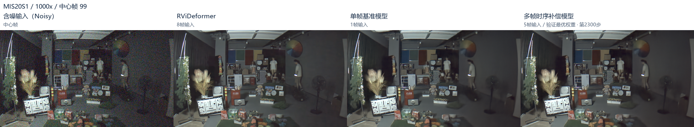
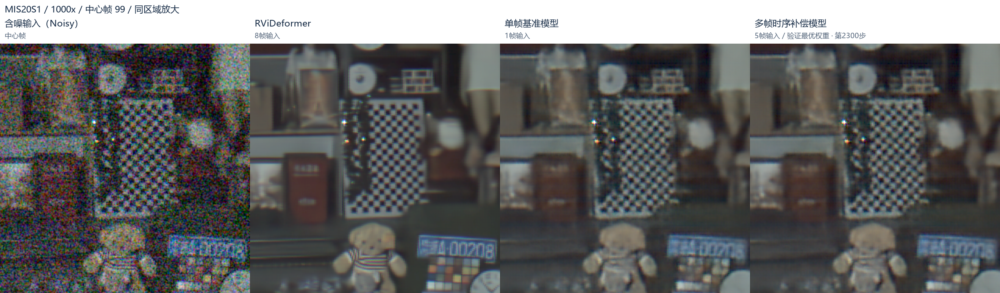
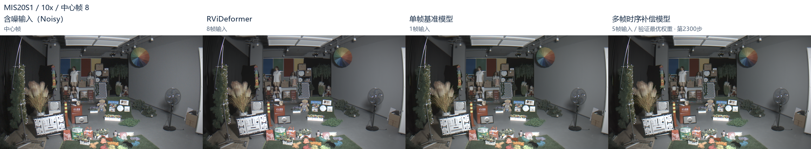
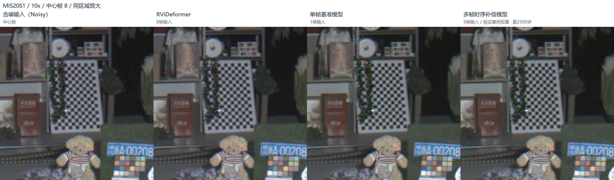
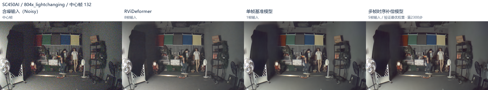
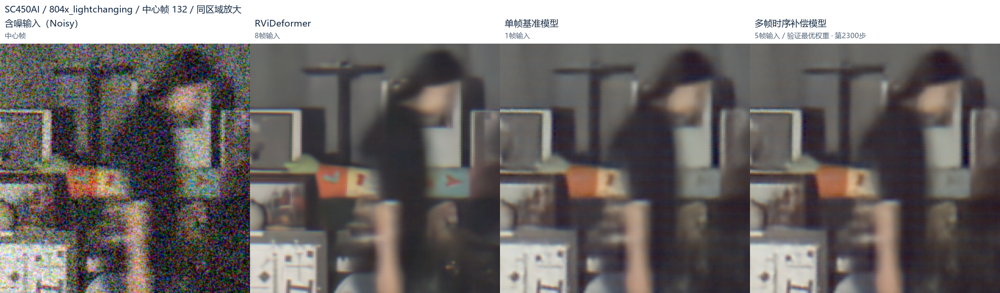
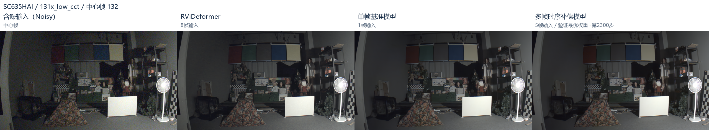
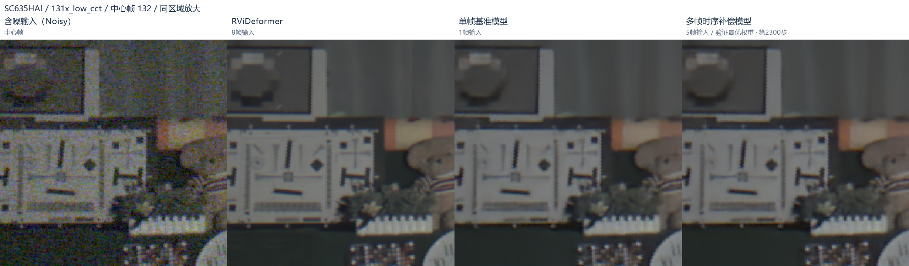

# 任务三：直接RAW去噪实验

## 目标与方案

输入公司低照度noisy RAW，输出中心帧去噪RAW，重点观察噪声、边缘纹理和运动区域。

```text
5帧RAW → 解码、减黑、归一化
           ├─ 中心帧 → 公司适配NAFNet三步恢复 ─┐
           └─ 五帧 → 多尺度对齐 → RAW修正 ────┴─ 相加 → 去噪RAW
```

ExposureDiffusion NAFNet主干约689.79万参数，五帧部分699,756个，合计约759.77万。主干使用官方SID权重初始化，4级编码器与解码器执行三步共享参数的光子条件恢复；五帧部分使用TAP对齐组件，在最终RAW输出上加修正，不改主干内部结构。

## 数据与动静区域监督

45条视频记录分为20条开发、18条独立标定和7条测试。开发数据涵盖5个传感器域，前约70%训练、中间隔10帧、后段验证；所有上下文限定在同一分区。测试来自未参与训练的传感器及场景，不参与选模型。

公司数据没有对应的干净真值，训练分区域：

- **静态：** 使用t+6独立有噪帧作Noise2Noise目标。
- **运动：** 使用冻结RViDeformer八帧输出的中心帧软目标。
- **不确定：** 不计算监督损失。

区域通过独立引导帧的时间变化判断，不使用语义分割或光流。先做5×5空间平均，将帧间方差除以预计噪声方差，4通道分数平均后，小于1.5为静态候选、大于3为运动候选，其余忽略。整体照明变化、近饱和位置和静态边界排除；最终模型还要求4通道、两个尺度的一致性检查。运动区域与教师有效标签取交集。

主干阶段使用7张引导帧；五帧训练使用8张，均避开学生输入和N2N目标。具体阈值、帧选择和边界处理见`project/code/company_exposure/core.py::guidance_masks`、`burst_detail/pilot.py::context/conservative_masks`。

两类区域分别计算均方误差，静态权重1、运动权重0.5。掩膜只用于训练，不用于推理拼图。MIS20S1按`raw16 >> 4`解码至DN12，其他视频按各自位位置读取。

## 训练与结果

| 设置 | 公司主干适配 | 五帧部分训练 |
|---|---|---|
| 更新范围 | 全部主干 | 冻结主干，只更新五帧部分 |
| 更新次数 | 1000 | 5000 |
| 学习率 | 1e−5 | 1e−4 |
| 有效batch | 32 | 8 |
| 四通道裁块 | 128×128 | 192×192 |
| 优化 | AdamW、权重衰减0、梯度裁剪1 | 同左 |
| 主要权重 | 第1000步 | 固定验证选第2300步 |

| 评价 | 基线 | 结果 | 变化 |
|---|---:|---:|---|
| 公司适配原验证 | 0.00018024991 | 0.00016020978 | 降低11.118% |
| 最终模型2300步 | 0.000179441815 | 0.000177245674 | 降低1.224% |
| 训练结束5000步 | 0.000179441815 | 0.000180480498 | 上升0.579% |

两阶段使用不同验证裁块与汇总设置，比例不累加。指标依赖有噪参考和教师，不代表真实画质提升比例，未报告干净GT的PSNR/SSIM。

完整实验完成165组同帧对比：独立测试105组、开发验证60组。本目录只保留下列4组，均为2300步结果，列顺序为 **Noisy / RViDeformer / 单帧基准 / 最终模型**。

## 代表图像

### MIS20S1 1000x，测试帧99





高噪声下最终模型与单帧基准接近，RVi的棋盘和玩偶条纹较易分辨。

### MIS20S1 10x，测试帧8





较低噪声下原图已保留更多结构，各方法差别较小。

### SC450AI，开发验证帧132





### SC635HAI，开发验证帧132





后两组为开发视频时间留出片段；不同增益的测试样例可能共享布景。

## 结论与不足

已实现公司RAW直接去噪、公司数据适配和五帧输出补偿，并在未参与训练的传感器及场景上完成抽帧测试。主干适配降低了参考误差；额外时序补偿的可见收益有限，不同区域结果不一致，尚未证明整体优于RVi。

主要限制为无干净GT、部分标定近似、纹理仍有模糊，以及未评价连续视频拖影和闪烁。各方法使用相同显示设置，RVi作为效果参考，不是干净答案。


## 代码与模型下载

[运行说明、代码位置及权重网盘链接](ExposureDiffusionNAFNet_DJC_experimental/README.md)。
