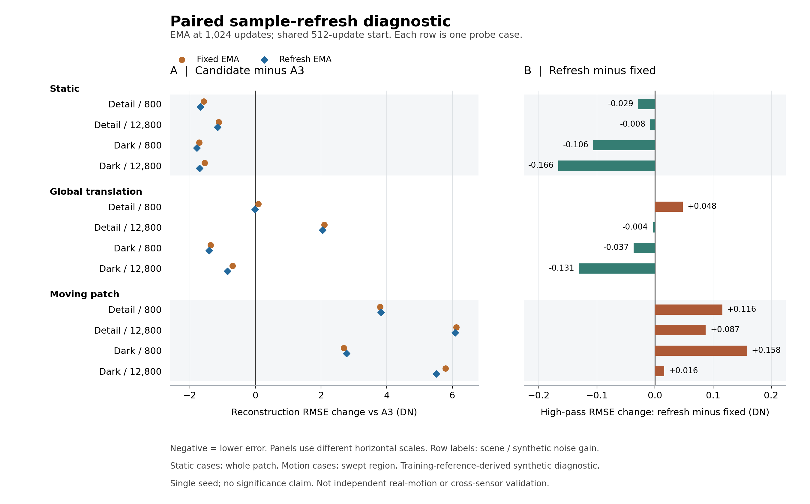

# A12 固定样本与周期刷新的对照结果（2026-10-30）

本轮固定组与刷新组均已完成训练，EMA 主结果不支持替换 A3。刷新组相对固定组在 12 个受控探针中有 10 个重建 RMSE 更低，原生三个窗口 PSNR 高 0.034–0.037 dB；但相比 A3，四个局部运动探针的重建、高通、梯度和时序误差全部升高，原生窗口 PSNR 低 0.237–0.270 dB。默认模型继续保留 A3 step-5000 EMA。

刷新组 model 的原生 PSNR 则比 A3 高 0.057–0.088 dB，但平坦区残差和时序 MAD 更高，四个局部运动案例的四项误差全部更差。静态重建收益与运动保真尚未兼顾，不能将这一补充结果当作联合验收通过。

实验设置见 [成对实验协议](A12_PAIRED_SAMPLING_PROTOCOL_2026-10-30.md)，此前 200 步可运行性检查见 [4090 短程结果](A12_SAMPLING_PILOT_4090_RESULT_2026-10-30.md)。本轮是采样刷新消融，未改变静态监督、模型或损失。

## 执行与比较条件

按用户确认使用物理 RTX 3090，按 UUID 隔离后逻辑设备为 cuda:0。公共阶段训练 512 步，固定与刷新分支各续训 512 步，正式更新共 1536 次，耗时 1984.20 秒（33 分 4 秒），保存 12 个检查点。正式训练峰值 PyTorch allocated/reserved 分别为 13.595/14.232 GiB；整个本轮训练及评估没有 OOM。短程恢复与重复性诊断另使用 6 次更新，不计入正式训练。

两分支的初始 model、EMA、Adam 和 RNG 与公共 step-512 检查点逐位一致。逐步样本身份、来源与增益日程、有效覆盖、日志步数及最终状态有限值均通过 CPU 核验。两周期都维持每周期 256 真实/256 合成；固定组重放首周期，刷新组改变裁块、真实时窗和合成噪声。首周期共享、来源/记录/增益顺序不变；不把本轮解释为原 A3 采样器的完整复现。

开始训练前完整审计发现刷新组 590、808、814 三个位置的监督掩码全空。离线按确定性候选规则更换这三个位置，保持来源/记录/增益，冻结替代文件后重新审计全部 2048 次样本读取。正式训练无运行时重采样、无跳过。三个替代样本有效覆盖分别为 93.0176%、99.9756%、59.8145%；全计划最低有效覆盖仍仅 0.048828%，低覆盖监督问题尚未解决。

GPU 连续两步与保存恢复两步的原严格容差检查未通过，失败记录保留。恢复起点完全一致；另一次连续重复运行产生相近量级差异，模型相对 L2 差异为 2.5587e-8，保存恢复对照为 2.8550e-8。本轮属于单种子探索，不声称端到端位级复现，也不将短程重复误差当作 1024 步漂移上界。

## 受控探针：主 EMA 结果

单位为参考 DN，误差越低越好。静态案例计全裁块，运动案例计 swept 区域。800/12800 是合成噪声标定档，不等于原始文件的增益标签。

| 场景 / 运动 / 噪声档 | A3 RMSE | 固定组 RMSE | 刷新组 RMSE | 刷新−固定 | 刷新−A3 高通误差 |
| --- | ---: | ---: | ---: | ---: | ---: |
| detail / static / 800 | 25.032 | 23.459 | 23.353 | -0.106 | -2.192 |
| detail / static / 12800 | 38.991 | 37.874 | 37.832 | -0.042 | -0.941 |
| detail / global_translation / 800 | 69.494 | 69.579 | 69.483 | -0.097 | -0.464 |
| detail / global_translation / 12800 | 89.952 | 92.050 | 91.992 | -0.058 | +0.662 |
| detail / moving_patch / 800 | 72.639 | 76.432 | 76.461 | +0.028 | +0.283 |
| detail / moving_patch / 12800 | 97.040 | 103.161 | 103.120 | -0.042 | +1.391 |
| dark / static / 800 | 11.280 | 9.563 | 9.491 | -0.072 | -2.671 |
| dark / static / 12800 | 15.063 | 13.515 | 13.358 | -0.157 | -2.364 |
| dark / global_translation / 800 | 15.526 | 14.158 | 14.115 | -0.044 | -1.841 |
| dark / global_translation / 12800 | 19.983 | 19.287 | 19.132 | -0.155 | -1.477 |
| dark / moving_patch / 800 | 60.211 | 62.904 | 62.984 | +0.080 | +0.477 |
| dark / moving_patch / 12800 | 84.355 | 90.148 | 89.858 | -0.290 | +1.481 |

刷新组相对固定组：重建误差 10/12 降低，高通 7/12 降低，梯度 8/12 降低，时序差分误差 7/12 降低。但四个局部运动案例的高通误差全部更高，梯度误差有三个更高；重建 RMSE 的小幅收益没有一致转化为高频结构收益。

刷新组相对 A3：静态四例的重建、高通、梯度均改善，时序误差四例均升高；八个运动案例有五个重建误差升高。其中四个局部运动案例的重建、高通、梯度和时序误差全部升高，重建增加 2.773–6.080 DN。不能称为运动细节恢复或去模糊改善。

公共 step-512 阶段就已出现四个局部运动案例重建及时序误差全部升高，故不能将全部回退归因于第二周期是否刷新。共同续训同时包含静态目标、初始化与新 Adam、来源交错日程等因素，本轮未单独分离这些因素的因果作用。



图中两面板横轴尺度不同；左侧比较候选与 A3，右侧比较刷新与固定。负值均代表误差更低，不跨案例平均，也不做显著性判断。

## 原生 1000x：主 EMA 的三个独立八帧窗口

三段分别推理及计分，均为 FP32、tile 64、stride 56、tile_batch=1。使用同一参考、掩码与归一化，不拼接稀疏时间段。以下 PSNR 仅作同场景增益留出的开发诊断。

| 帧段 | A3 PSNR | 固定组 PSNR | 刷新组 PSNR | 刷新−A3 | 刷新−固定 |
| --- | ---: | ---: | ---: | ---: | ---: |
| 0–7 | 53.63678 | 53.32996 | 53.36668 | -0.27010 | +0.03672 |
| 96–103 | 53.76728 | 53.48764 | 53.52208 | -0.24520 | +0.03444 |
| 192–199 | 53.26647 | 52.99452 | 53.02898 | -0.23749 | +0.03446 |

| 帧段 | A3 RMSE | 固定组 RMSE | 刷新组 RMSE | A3 平坦区残差 σ | 固定组 σ | 刷新组 σ |
| --- | ---: | ---: | ---: | ---: | ---: | ---: |
| 0–7 | 8.5195 | 8.8258 | 8.7886 | 6.3220 | 6.4163 | 6.4139 |
| 96–103 | 8.3925 | 8.6671 | 8.6328 | 6.5395 | 6.6287 | 6.6258 |
| 192–199 | 8.8906 | 9.1733 | 9.1370 | 6.8529 | 6.9487 | 6.9417 |

固定与刷新组的三个窗口重建误差和平坦区残差均高于 A3。刷新组相对固定组的 native 改善幅度有限，仍未达到 A3。高频幅度比和时序 MAD 是诊断量，不能独立代表真实细节或时序保真。

## model 与公共阶段诊断

EMA 为预先指定的主候选，model 只用于诊断。以下为各权重相对同协议 A3 EMA 的原生 PSNR 变化（dB）。

| 权重 | 0–7 | 96–103 | 192–199 |
| --- | ---: | ---: | ---: |
| shared512_ema | -0.22937 | -0.20778 | -0.19912 |
| shared512_model | -0.56660 | -0.52819 | -0.49405 |
| fixed1024_ema | -0.30682 | -0.27965 | -0.27195 |
| fixed1024_model | -0.56808 | -0.52697 | -0.51032 |
| refresh1024_ema | -0.27010 | -0.24520 | -0.23749 |
| refresh1024_model | +0.08772 | +0.08296 | +0.05729 |

公共阶段 EMA 已有 native 回退；shared 与 fixed 的 model 也低于 A3 和各自 EMA。但刷新组 model 的三个窗口 PSNR 比 A3 高 0.05729–0.08772 dB，比固定组 model 高 0.56761–0.65579 dB。model 与 EMA 的结果确有差异，不能将 EMA 的静态重建回退外推为所有权重均无改善。

刷新组 model 的静态收益仍伴随代价：相对 A3，三个窗口平坦区残差 σ 增加 0.18357–0.21145 DN，时序 MAD 增加 0.09275–0.09985 DN，高频幅度比下降约 0.01008–0.01050。四个局部运动案例的重建、高通、梯度和时序误差全部更高，重建增加 9.089–13.839 DN。高频幅度或 MAD 不能单独证明模糊，但总体重建、平坦区与运动指标并未同时改善。

两组最终 model 的运动重建误差均有 6/8 高于 A3。预先指定的 EMA 主候选保持不变，model 的 native PSNR 收益完整记录为诊断结果，不能以更换评分权重的方式认定联合验收通过。

刷新 model 相对固定 model 的重建误差有 7/12 降低，但高通与梯度误差均有 8/12 升高，不能用单项重建收益替代联合验收。

## 结论、边界与下一步

这轮已经得到方向性答案：样本刷新带来了部分重建收益，刷新组 model 的原生重建改善也值得保留；但 EMA 主结果仍有原生静态回退，两类权重的局部运动损失都未解决。维持 A3，不将本轮候选用于替换默认权重。按照预先约定，候选未在静态与运动上取得兼顾改善，因此本轮不继续扩展候选跨传感器推理及真实动态视觉验收。

受控探针由训练参考派生，原生参考包含评分帧，均不构成独立干净真值；只有单种子、两个周期，刷新组还包含三个非空监督替代样本。没有完成独立真实动态验收、未知传感器留出验证、多种子重复或部署阈值制定，最终“去噪、保高频、不模糊、多传感器泛化”目标仍未实现。

下一步应先推进动态监督的数据准入：核对是否已有新的多场景低增益逐帧动态 RAW，按物理场景划分训练与验证，检查运动边缘、曝光模糊、残余噪声、NR 旁路及 RAW 元数据。沿用 [A7 采集与验收协议](A7_REAL_MOTION_CAPTURE_PILOT_2026-10-09.md) 和现有 validator，不把当前程序化贴片或旧教师输出登记为独立干净动态真值。数据达标后，再用同帧动态目标、静态回放和匹配的静态续训对照开展小预算实验；模型与损失其他部分保持固定。

此后已完成 [A13 数据准入检查](A13_DYNAMIC_DATA_READINESS_2026-10-30.md)：用户暂无新增数据，旧 10x 源的相邻帧噪声筛查未通过，当前尚不具备新一轮多场景动态训练与独立验证条件。

此前 A5 的静态续训对照已出现 native 漂移，A6 的单场景动态/程序化运动及教师蒸馏、A7 的推理融合也未产生可采纳候选。下一轮需增加有效监督与独立验证依据，不重复同一数据上的权重扫描。动态与静态共同达标后，再进行多传感器留出评估和对应噪声退化适配。

## 复核入口

七套权重均完成 12 个探针和三个原生窗口，共 105 个预测。汇总器核对检查点与预测哈希、精确 model/EMA 身份、3090 UUID 与运行时、有限 FP32 数组、窗口输入及掩码、参考协议和评分区域；全部通过。相关采样、训练、评估测试 66 项通过，汇总器测试另 6 项通过。

最终评估曾因会话中断留下部分 refresh EMA native 输出。确认原进程已退出且无 OOM 记录后，将部分输出和原 status 原样保存在 `native_interrupted_20261030/`、`status_native_interrupted_20261030.json`，按同协议重新评完三个窗口；没有重启训练。完成批次的状态为 `evaluation_completion_status.json`，原中断批次的状态文件保留作历史记录。

- [版本化指标 CSV：探针](assets/a12_paired_20261030/probe_metrics.csv)、[原生窗口](assets/a12_paired_20261030/native_metrics.csv)：全部七套权重的关键指标及双对照差值，未跨案例平均。
- [版本化复核与身份摘要](assets/a12_paired_20261030/result_verification.json)：检查点、审计、运行时、源文件和导出指标的哈希及中断保留记录。
- [完整汇总](../artifacts/a12_paired_summary_20261030/summary.json)、[训练核验](../artifacts/a12_paired_work_20261030/final_training_verification.json)、[GPU 重复性诊断](../artifacts/a12_paired_work_20261030/gpu_resume_repeatability_comparison.json)。
- [独立主结果审查](../artifacts/a12_paired_work_20261030/review_20261030.json)、[原生主结果审查](../artifacts/a12_paired_work_20261030/native_primary_analysis.json)、[最终 model 权重审查](../artifacts/a12_paired_work_20261030/final_model_analysis.json)。
- 正式检查点位于 `artifacts/a12_paired_shared_20261030/checkpoint_step_000512.pth`、`artifacts/a12_paired_fixed_20261030/checkpoint_step_001024.pth`、`artifacts/a12_paired_refresh_20261030/checkpoint_step_001024.pth`；完整 SHA-256 见版本化身份摘要。

汇总复现：

```bash
/home/jingzeliang/miniconda3/envs/aaa_312/bin/python scripts/summarize_a12_paired.py \
  --manifest configs/a12_paired_evaluation_20261030.json \
  --output-dir artifacts/a12_paired_summary_recheck_20261030
```

输出目录必须尚不存在；已有评估与结果不会覆盖。图形复现入口为 `docs/assets/a12_paired_20261030/make_probe_figure.py`。
